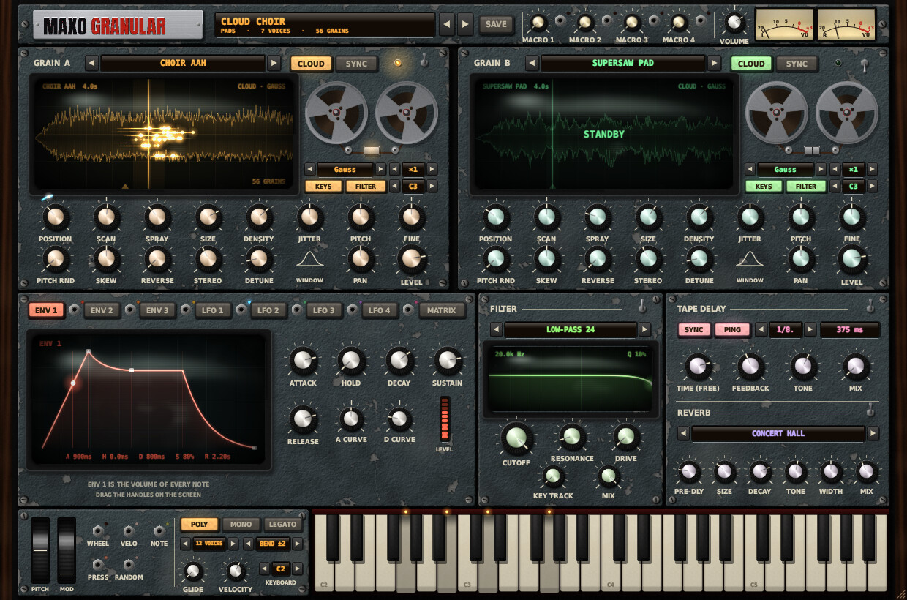
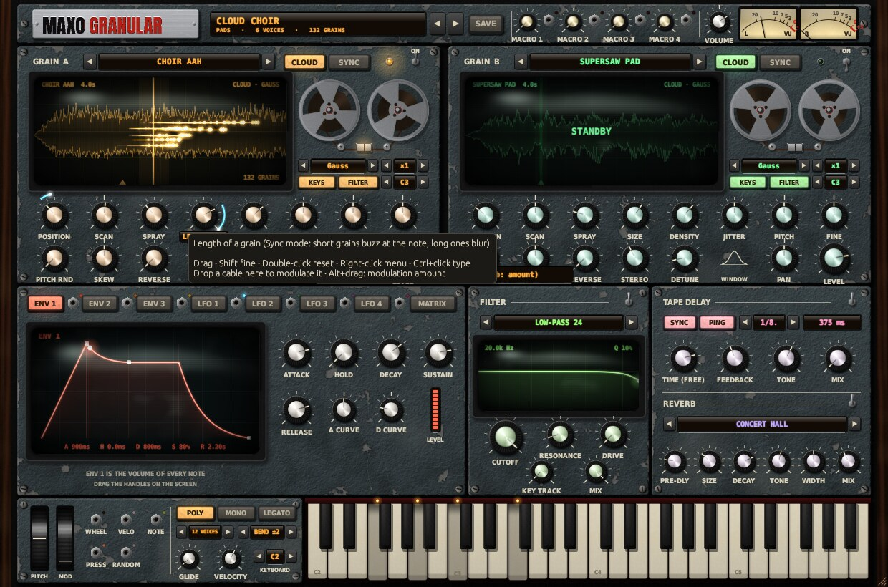

<div align="center">

# MaxoGranular

Granular synthesizer (VST3 instrument) written in Rust.

[**Download**](https://github.com/xslimakx/MaxoGranular/releases/latest)

</div>



MaxoGranular cuts sounds into tiny grains and plays them back as clouds, pads, textures or playable tones. Everything a granular synth needs and nothing else, behind a worn analog rack: hammertone module plates with chipped paint, knurled knobs, phosphor CRT screens where every grain glows, tape reels that turn with the scan, lit push buttons, VU meters and patch cables for modulation.

## Sound

| Section | What it does |
|---|---|
| **Grain A / Grain B** | Two grain generators. Source: **your own sound** (LOAD, or drag a WAV / AIFF / FLAC / MP3 / OGG / M4A file onto the window: left half = A, right half = B) or one of 24 built-in sounds. **Cloud** mode: grains at random times (Density per second). **Sync** mode: grains locked to the note's pitch - playable tones, Pitch moves the formant. |
| Grain controls | Position (also drag on the screen), Scan (forwards / backwards / frozen), Spray, Size 1 ms - 2 s, Density, Jitter, Pitch, Fine, Pitch random, Skew, Reverse, Stereo, Detune, Pan, Level; window shape (Hann, Gauss, Triangle, Tukey, Decay, Swell), up to 8 streams, key tracking, root note. |
| **Filter** | 7 types (LP 12 / 24, HP 12 / 24, band, notch, peak), cutoff, resonance, drive, key tracking, mix; drag the response curve. |
| **Modulation** | 3 envelopes (attack, hold, decay, sustain, release, curves; drag the handles on the screen), 4 drawn LFOs (free / retrig / 1-shot, synced to the tempo, 23 shapes to start from), velocity, note, mod wheel, aftertouch, random, 4 macros. |
| Patching | **Drag a cable from any jack onto any knob.** A coloured ring shows the amount; Alt+drag on the knob changes it; right-click a knob or open the MATRIX for every route (up to 32). |
| **Effects** | Tape delay (synced, ping-pong) and reverb (14 types). |
| Voices | Poly / Mono / Legato, up to 16 voices, glide, pitch bend range, velocity amount. |
| Presets | 57 factory presets in 9 categories, favourites, your own presets. |
| Playing | MIDI, the on-screen keyboard and wheels, or the computer keyboard (A W S E D F T G Y H U J K O L P, Z / X octave). |



## Install

Download the zip for your system from the releases, put `MaxoGranular.vst3` into your VST3 folder (Windows: `C:\Program Files\Common Files\VST3`, macOS: `~/Library/Audio/Plug-Ins/VST3`, Linux: `~/.vst3`). Load your own sounds with LOAD or by dragging files onto the window; files in the `MaxoGranular/Samples` folder of your user data folder show up in the source menu. On Linux the LOAD dialog uses zenity or kdialog.

## Build

```
cargo xtask bundle maxogranular --release
```

The textures are rendered by `tools/render_textures.py` (numpy, Pillow, scipy).

## License

MIT
